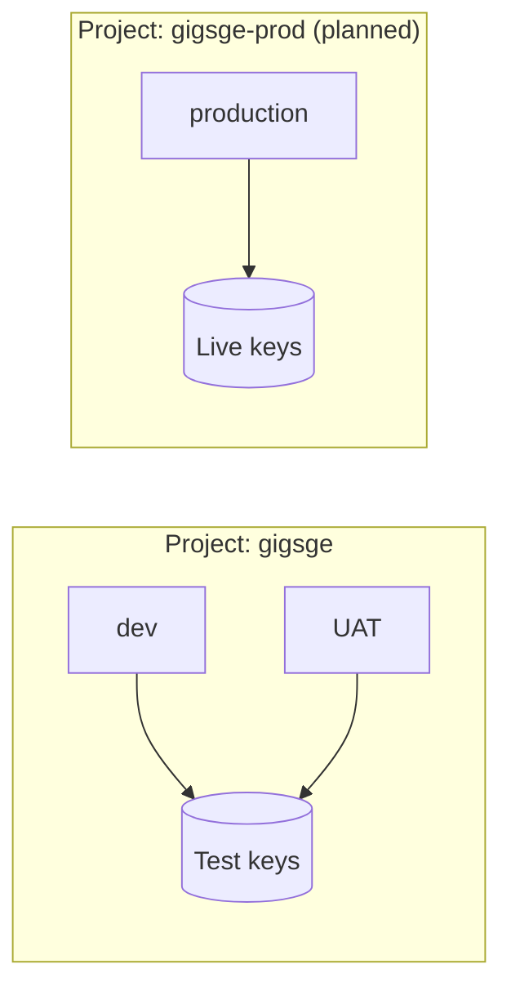

# Environments and Third-Party Integrations

How dev, UAT, and (future) production use outside services such as email, SMS, and payments, without ever moving real money or texting real people from a test environment.

## The rule: same code, different keys

Every environment runs the **same code**. What differs is configuration: which key it holds and which mode the provider runs in. Most serious providers issue two kinds of key:

- **Test (sandbox) keys** behave like the real service, but no money moves and no real message is sent. Payment providers supply test card numbers.
- **Live keys** move real money and send real messages.

**Only production ever holds live keys.** If dev or UAT cannot see a live key, it cannot charge a real card, even by mistake.

For services without a test mode, the code uses a **fake provider** that records what it would have sent. Email worked this way before Resend: the verification code came back in the API response as `development_code`.

## What each environment uses

| Service | Dev | UAT | Production |
|---------|-----|-----|------------|
| Email (Resend) | Real (cheap, harmless) | Real | Real |
| SMS | Fake: code shown on screen | Real only to an allow-list of team/tester phones; fake for everyone else | Real |
| Payments | Test keys | Test keys | Live keys |

Dev and UAT may **share one set of test keys**: a test key cannot move real money, so isolating them buys little. That keeps the setup to **two keys per provider**, one test and one live.

## Production gets its own cloud project

Dev and UAT live in the `gigsge` Google Cloud project. Before launch, production should live in a separate project (for example `gigsge-prod`) because:

1. **Live keys exist only there.** Nobody working on dev or UAT, human or AI agent, can read them.
2. **Stronger data protection.** Daily backups and deletion protection on the database from day one.
3. **Separate access and billing.** Fewer people need production access, and its costs are visible on their own.

The same `cloudbuild.yaml` serves all three: a production trigger supplies the production names. See [operations/cloud-inventory.md](../operations/cloud-inventory.md).

## Safety rails in code (build with the first integration)

- **Explicit mode switch.** Each integration reads a `*_MODE=test|live` setting. The API refuses to start if it holds a live key while not in production, or a test key while in production.
- **Separate webhooks.** Payment providers call back to tell us a payment succeeded. Test-mode webhooks point at dev/UAT and live-mode webhooks at production only. Every webhook verifies the provider's signature.
- **Production smoke test.** After go-live, make one small real payment and refund it, and send one real SMS to the owner's phone.

## Current product scope

- **Payments are not in v1.** Per [SYSTEM_DESIGN.md](../../SYSTEM_DESIGN.md) (§9.8), users pay monthly fee invoices by bank transfer and an admin marks them paid. Automated bank matching is planned for v2.
- **SMS is optional for launch.** Phone verification is optional under the 2026-10-14 product decision.

When choosing providers, **require a test mode**. Georgian banks and SMS gateways vary on this, so confirm it before signing a contract.

## Who does what

| Step | Owner |
|------|-------|
| Sign provider contracts, pass business verification, obtain test and live keys | Product owner |
| Paste keys into Secret Manager, or into a terminal prompt (never into chat) | Product owner |
| Integration code, mode switch, webhooks, trigger settings, testing on dev and UAT | Engineering (agent) |

Related: [cloud-inventory.md](../operations/cloud-inventory.md), [improvement plan](../planning/improvement-plan.md).
