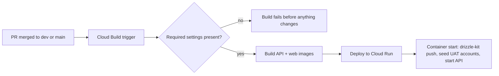

# Cloud Inventory

What runs where, by name. No secret values ever belong in this file. Update it in the same PR as any infrastructure change.

Project: **`gigsge`** (Google Cloud, region `us-central1`). DNS: Cloudflare (records "DNS only").

## Environments at a glance

| | Dev | UAT |
|---|---|---|
| Git branch | `dev` | `main` |
| Web | https://dev.gigs.ge (`gigsge-web-dev`) | https://uat.gigs.ge (`gigsge-web`) |
| API | https://api.dev.gigs.ge (`gigsge-api-dev`) | https://api.uat.gigs.ge (`gigsge-api`) |
| Deploy trigger | `deploy-gigsge-dev` | `deploy-gigsge-uat` |
| Cloud SQL instance | `gigsge-dev-db` | `gigsge-uat-db` |
| Database / login | `gigsge_dev` / `gigsge_dev_app` | `gigsge` / `postgres` |
| API identity | `gigsge-api-dev-runtime@…` | `gigsge-api-uat-runtime@…` |
| Email queue | `auth-email-dev` | `auth-email-uat` |
| Photo bucket (public read) | `gs://gigsge-dev-media` | `gs://gigsge-uat-media` |
| Secrets | `db-password-dev`, `jwt-access-secret-dev`, `jwt-refresh-secret-dev`, `resend-api-key-dev` | same names with `-uat` |

There is **no production environment** yet. The plan is in [environments-and-integrations.md](../architecture/environments-and-integrations.md).

## How a deploy works

The first build step refuses to run if any environment setting is missing. That stops a half-configured trigger from deploying UAT with dev's database or keys. The schema is applied by `drizzle-kit push` at container start (`apps/api/entrypoint.sh`), so additive schema changes deploy automatically.

## Trigger settings (substitutions)

Each trigger must define exactly these keys. Cloud Build also fails if a trigger defines a key the build file does not use.

`_API_SERVICE`, `_WEB_SERVICE`, `_API_URL`, `_FRONTEND_URL`, `_DB_INSTANCE`, `_DB_NAME`, `_DB_USER`, `_DB_PASSWORD_SECRET`, `_JWT_ACCESS_SECRET_NAME`, `_JWT_REFRESH_SECRET_NAME`, `_RESEND_API_SECRET`, `_AUTH_EMAIL_QUEUE`, `_MEDIA_BUCKET`, `_API_RUNTIME_SERVICE_ACCOUNT`

Values are **names** of secrets, never the secrets themselves.

## Identities and permissions

| Identity | Used by | Has |
|----------|---------|-----|
| `gigsge-api-{dev,uat}-runtime` | API services | Cloud SQL Client; Secret Accessor on its own 4 secrets; Cloud Tasks Enqueuer on its own queue; Storage Object Admin on its own photo bucket only |
| `723467137798-compute@developer…` | Both deploy triggers, both web services | Project **Editor** (too broad; see the plan); Service Account User on both runtime identities |
| `723467137798@cloudbuild…` | Nothing currently | Legacy roles, including project-wide Secret Accessor (candidate for removal) |

## Database safety

| Instance | Tier | Backups | Deletion protection |
|----------|------|---------|---------------------|
| `gigsge-dev-db` | db-f1-micro, 10 GB HDD | off (dev data is disposable) | on |
| `gigsge-uat-db` | db-f1-micro, 10 GB HDD | **off** | on (since 2026-10-19) |

## Operational gotchas

- **Rotating a secret:** add a new secret version, then start a new Cloud Run revision (any `gcloud run services update`). Running instances keep the old value until they restart.
- **Plain env var → secret:** Cloud Run refuses to switch a variable's type in one update. Remove the plain variable first.
- **Editing trigger settings:** `gcloud builds triggers update github --update-substitutions` fails on these triggers. Export with `describe`, edit, and re-`import`. Delete the temp file afterward.
- **Testing email without a real inbox:** register `delivered+<anything>@resend.dev`, then look for log events `auth_email_queued` and `auth_email_accepted`.

Related: [uat-runbook.md](../guides/uat-runbook.md) (setup history and smoke checks), [sdlc-and-cicd.md](../guides/sdlc-and-cicd.md).
