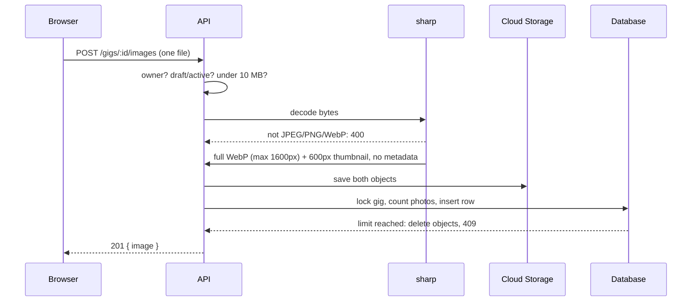

# Spec: Gig Photos

**Status:** Delivered 2026-10-20. **Owner decision:** D11 in [feat-public-gig-board.md](./feat-public-gig-board.md), Google Cloud Storage.

## Why

Posters asked for photos so workers can judge a job at a glance. A photo on each board card also makes the public homepage feel alive for visitors who are not logged in yet.

## What the user sees

| Who | Sees |
|-----|------|
| Anyone on the board | The cover photo as a small thumbnail on the gig card |
| Logged-in viewer on the gig page | The cover photo, plus the other photos if the poster's **Extra photos** setting allows it (default: verified users) |
| Poster | All photos. Can add (up to 10), remove, and choose the cover from the gig page while the gig is a draft or active |

Photos can also be chosen in the **Post a gig** form. The first one becomes the cover. If some uploads fail, the gig still goes live and the form explains which photos failed.

## Why photos are not stored in the database

Images are large and are read far more often than they are written. Keeping them in the database would bloat backups and make every page load hit the database for bytes it does not need. A storage bucket serves files directly to the browser, cheaply and with caching. The database stores only the two URLs and a storage key.

## Why Google Cloud Storage instead of Cloudflare R2

Both cost pennies at this scale. Google Cloud Storage lives in the same `gigsge` project as the rest of the platform, so the API authenticates with its existing service identity. No new account, no access keys to store or rotate. R2 has free egress, which may matter at much higher traffic. The storage code is isolated in one file (`apps/api/src/lib/media-storage.ts`), so switching later is a small change.

## How an upload works

**Privacy:** phone photos often carry GPS coordinates of the poster's home. The API re-encodes every image, which drops all metadata. A test proves the stored file has no EXIF block.

**Trusting content, not labels:** the browser's declared file type is ignored. `sharp` must successfully decode the bytes as JPEG, PNG, or WebP.

## API

| Method | Path | Result |
|--------|------|--------|
| POST | `/api/v1/gigs/:id/images` | 201 `{ image }`; 400 not an image; 403 not owner; 409 limit or wrong status; 413 over 10 MB; 503 storage not configured |
| DELETE | `/api/v1/gigs/:id/images/:imageId` | 204; removes both files. If it was the cover, the next photo becomes the cover |
| POST | `/api/v1/gigs/:id/images/:imageId/cover` | 200 `{ image }` |

`GET /gigs` returns `images` with only the cover. `GET /gigs/:id` returns all photos the viewer may see. Each image is `{ id, url, thumbUrl, isPreview }`.

## Storage layout and configuration

- Buckets: `gigsge-dev-media`, `gigsge-uat-media` (public read; objects have unguessable UUID names)
- Objects: `gigs/{gigId}/images/{uuid}.webp` and `{uuid}-thumb.webp`
- Each API identity can write only to its own environment's bucket
- `MEDIA_BUCKET` env var, set from the Cloud Build trigger substitution `_MEDIA_BUCKET`. Empty locally, which makes uploads answer 503

## Out of scope (follow-ups)

- Avatars, application attachments, dispute evidence (evidence needs a private bucket)
- Reordering photos beyond choosing the cover
- Cleaning up bucket files when a whole gig is deleted (gigs are not deleted today)
